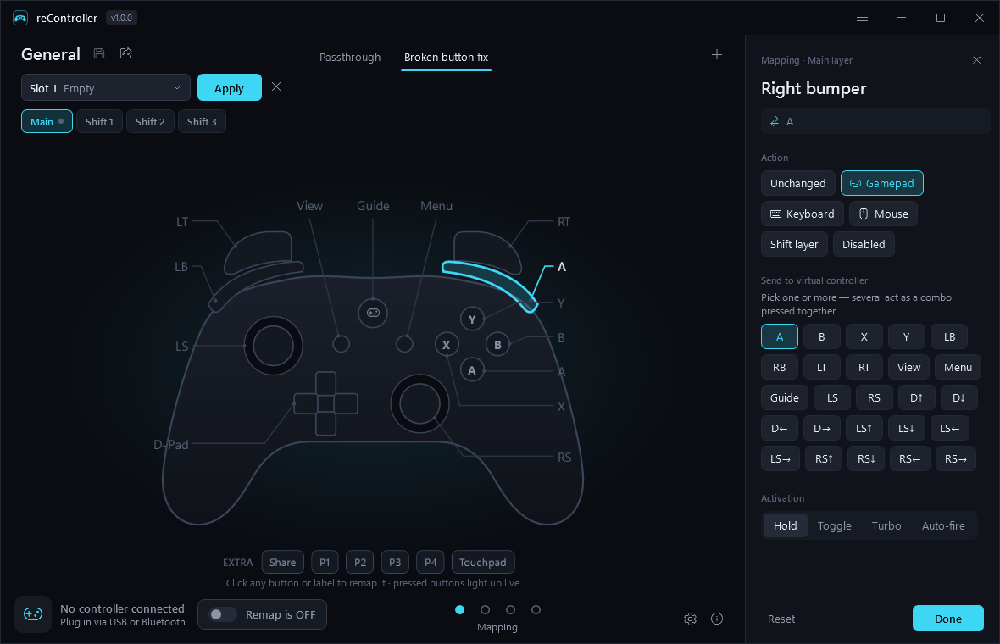
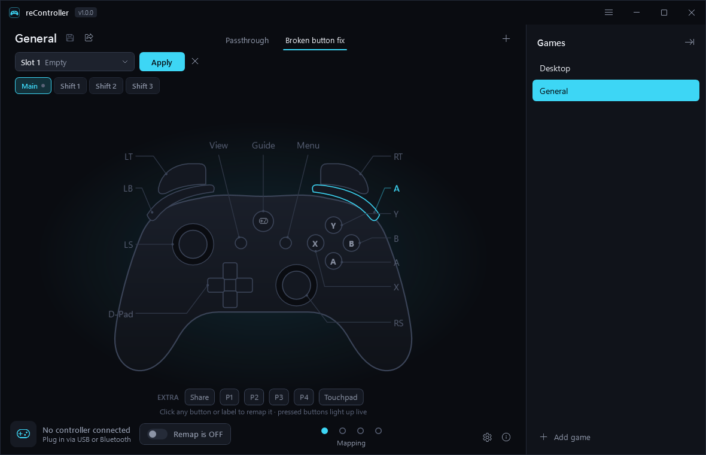
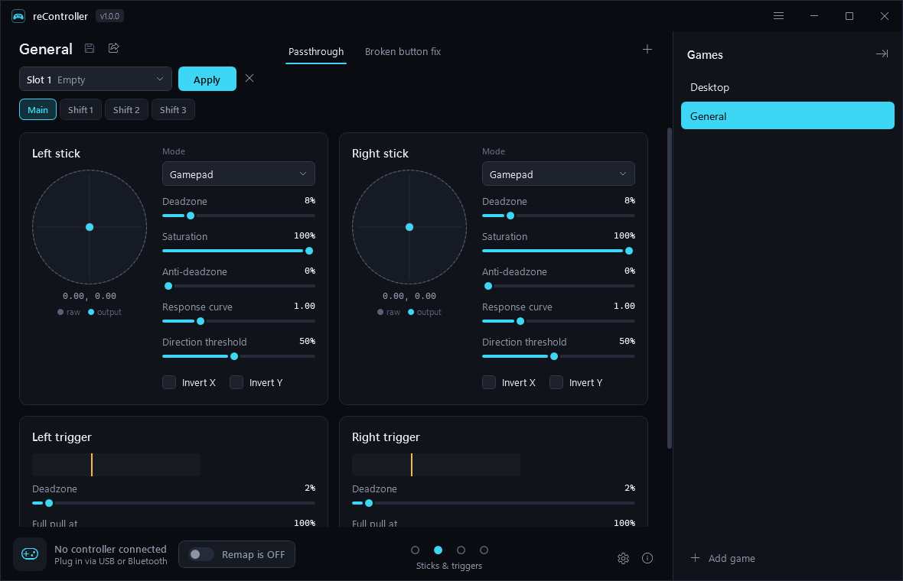
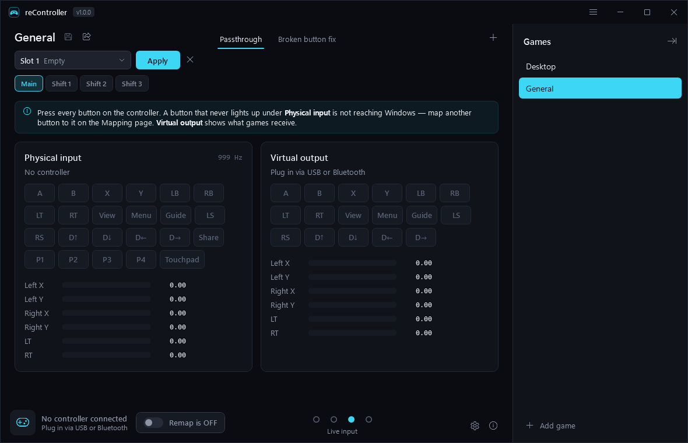
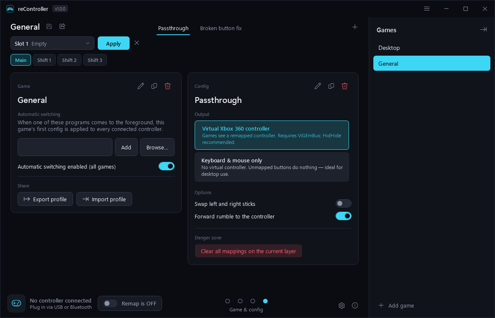

<p align="center">
  
</p>

<h1 align="center">reController</h1>

<p align="center">
  <b>Free, open-source controller remapper for Windows.</b><br/>
  Fix a broken button, remap anything to anything, add turbo, toggles and shift layers. No subscription, no telemetry.
</p>

<p align="center">
  
</p>

---

## Why

A single dead button can make an otherwise perfect controller useless. Commercial remappers work but are paid and closed; free ones are often unmaintained or flaky. reController is built to be **reliable first**: a dedicated 1000 Hz engine, a stuck-key-proof output pipeline, crash-safe profile storage and a UI that shows you live what your controller is doing.

## Features

| | |
|---|---|
| 🎮 **Remap any control** | Buttons, triggers and each stick direction → gamepad buttons, keyboard keys / combos, mouse buttons or the scroll wheel |
| 🩹 **Broken-button fix** | Map a spare button (bumper, paddle, stick click…) onto the dead one, or *disable* a button that sends ghost presses |
| ⚡ **Activation modes** | Hold, Toggle, Turbo (2–30 presses/s), Auto-fire |
| 🧩 **Shift layers** | 3 extra layers; hold or toggle a button to switch the whole layout. Unmapped controls fall back to the main layer |
| 🕹️ **Sticks & triggers** | Radial deadzone, saturation, anti-deadzone, response curve, inversion, stick-as-mouse, hair triggers, adjustable press thresholds — with live previews |
| 🎰 **4 slots per controller** | Hold *Guide* + D-Pad to switch configs from the controller itself |
| 🔄 **Auto profile switching** | Link a game's `.exe`; its config is applied when the game gets focus |
| 🔬 **Live input tester** | See every physical button and axis in real time — find out instantly which button is dead |
| 🧑‍🤝‍🧑 **Many controllers** | Xbox / XInput pads via XInput; DualShock 4, DualSense (incl. Edge paddles), Switch Pro and generic pads via SDL3 |
| 📤 **Share profiles** | Export / import `.rcprofile` files |
| 🖥️ **Polished app** | Tray icon, start with Windows, single instance, 6 accent colours, per-monitor DPI, portable mode |

## Screenshots

| Mapping | Sticks & triggers |
|---|---|
|  |  |
| **Live input** | **Game & config** |
|  |  |

## Install (portable — nothing else to download)

1. Download **`reController-x.y.z-portable.zip`** from the [Releases](../../releases) page and unzip it anywhere (Desktop, USB stick…).
2. Double-click **`reController.exe`**.
3. The first time, a **One-time setup** window appears. Click **Install** and approve the Windows prompt.
4. Restart Windows if it asks you to. Done.

That's all. Windows 10 (1809+) or 11, 64-bit. No .NET or other runtime needed.

<details>
<summary>What does the one-time setup install?</summary>

reController needs two small, free, digitally signed drivers by Nefarius Software Solutions. Their official installers are **built into `reController.exe`** and run silently, so you never have to find or download them:

| Driver | Why |
|---|---|
| **ViGEmBus 1.22** | Creates the virtual Xbox 360 controller that games see. Required for controller output (keyboard/mouse-only configs work without it). |
| **HidHide 1.5** | Hides your physical controller from games so they don't receive every button twice. Recommended. After it's installed, use *Settings › Drivers › Manage…* to pick which controller to hide. |

A broken or outdated ViGEmBus installation is detected and repaired the same way. You can re-run the setup at any time from *Settings › Drivers › Install / repair*, or unattended with `reController.exe --install-drivers`.
</details>

Prefer settings in `%AppData%` instead of next to the exe? Use `reController-x.y.z-win-x64.exe` (same app, single file) or delete `portable.txt` from the zip.

### Fix a broken button in 60 seconds

1. Plug in the controller. Open the **Live input** page (third dot at the bottom) and press every button — the one that never lights up is the broken one.
2. Go back to **Mapping**, click the button you want to *use instead* (e.g. a bumper you rarely need or a back paddle).
3. In the panel on the right choose **Gamepad** and pick the broken button as the target.
4. Press **Apply**. Done — games now receive the broken button whenever you press the replacement.

The built-in *General › Broken button fix* config is an example (right bumper → A).

## Concepts

* **Game** — a profile for one game or app, optionally linked to executables for automatic switching.
* **Config** — a complete mapping (tabs at the top). A game can have several, e.g. *On foot* / *In vehicle*.
* **Slot** — each controller has 4 slots; *Apply* puts the current config in the selected slot. Switch slots with *Guide + D-Pad ↑ → ↓ ←* (configurable).
* **Layers** — *Main* plus *Shift 1–3*. Assign **Shift layer** to a button to activate a layer while it's held (or toggle it).
* **Output** — *Virtual Xbox 360 controller* (default) or *Keyboard & mouse only*.

## How it works

```
 physical pad ──► XInput / SDL3 ──► MappingEngine (1000 Hz, per controller) ──┬──► ViGEmBus virtual Xbox 360 pad ──► game
      │                                                                      └──► SendInput (scan codes, mouse) ─► game
      └── hidden from games by HidHide (reController is whitelisted)
```

* The engine runs on a dedicated real-time thread (MMCSS "Games" class, high-resolution waitable timer). At 1000 Hz polling it uses roughly 3 % of one CPU core (measured on Windows 11); lower rates are available in Settings.
* Outputs are computed as a **desired state** each tick and diffed against what is currently held, so a key can never be left stuck — turning remapping off, switching configs or closing the app always releases everything.
* A binding is captured when its button is pressed and released with the same binding, so changing layers mid-press can't strand an output.
* Profiles are JSON files written atomically (temp file + flush + replace). A corrupt file is renamed to `*.corrupt` and skipped instead of crashing the app.

## Command line

| Option | Description |
|---|---|
| `--minimized` | Start in the tray (used by *Start with Windows*) |
| `--install-drivers [vigembus] [hidhide]` | Install / repair the bundled drivers without the UI (one UAC prompt). Exit code 0 = done, 3010 = restart needed. |
| `--selftest [report.txt]` | Checks XInput, SDL3, bundled and installed drivers and performs a real virtual-controller round trip (plug in a virtual pad, remap RB → A through the engine, read it back via XInput). Exit code 1 if a critical check fails. Attach the output to bug reports. |
| `--screenshot out.png [--config name] [--page 0-3] [--select Control] [--overlay settings\|about]` | Renders the UI to a PNG (used for docs and visual checks) |

## Data & portable mode

* Profiles & settings: `%AppData%\reController` · Logs: `%LocalAppData%\reController\logs`
* **Portable mode** (default in the portable zip): when `portable.txt` sits next to `reController.exe`, everything is stored in a `data` folder beside it.

## Troubleshooting

| Symptom | Fix |
|---|---|
| Game reacts twice / to the original button | Install HidHide and hide the physical controller (*Settings › Drivers › Manage…*), then reconnect it. |
| "ViGEmBus needs a quick repair" | The driver is half-installed or outdated. Click *Set up now* (or *Settings › Drivers › Install / repair*), approve the prompt and restart Windows. `reController --selftest` confirms the fix. |
| Keyboard/mouse output doesn't reach a game | The game probably runs as administrator; Windows blocks input from non-elevated apps. Run reController as administrator too. |
| PlayStation / Switch controller not detected | Close Steam (Big Picture can claim the device) or disable Steam Input for it, then replug. |
| Online game with anti-cheat | Some anti-cheat systems block virtual controllers or injected input. Use at your own discretion. |

## Building from source

```powershell
git clone <this repository>
cd reController
dotnet test                                    # 40+ unit tests
dotnet run --project src/ReController.App      # debug run
.\build\package.ps1                            # full release -> dist/ (portable zip + exe + checksums)
```

Requires the .NET 8 SDK (Visual Studio 2022 17.8+, Rider or VS Code). The first build downloads the official signed ViGEmBus/HidHide installers into `redist/` (SHA-256 pinned, signature verified by `build/fetch-redist.ps1`) and embeds them; build with `-p:SkipRedist=true` to skip that. An optional classic installer can be built with [Inno Setup 6](https://jrsoftware.org/isinfo.php): `iscc installer\reController.iss`.

### Project layout

| Project | Responsibility |
|---|---|
| `ReController.Core` | Platform-independent domain model, mapping engine, stick/trigger shaping, profile & settings storage. 100 % unit-testable. |
| `ReController.Platform.Windows` | XInput & SDL3 input, ViGEmBus output, SendInput, HidHide integration (via a locked-down elevated helper), engine thread, diagnostics. |
| `ReController.App` | WPF UI (MVVM with CommunityToolkit.Mvvm), theming, tray, single-instance, logging (Serilog). |
| `tests/*` | xUnit tests for the engine, storage, parsers and security validation. |

## Contributing

Issues and pull requests are welcome — see [CONTRIBUTING.md](CONTRIBUTING.md). Security issues: see [SECURITY.md](SECURITY.md).

## License & credits

reController is released under the [MIT License](LICENSE).

Third-party licenses are listed in [THIRD-PARTY-NOTICES.md](THIRD-PARTY-NOTICES.md). Built on [ViGEmBus](https://github.com/nefarius/ViGEmBus) and [HidHide](https://github.com/nefarius/HidHide) by Nefarius Software Solutions, [SDL3](https://libsdl.org) (zlib), [CommunityToolkit.Mvvm](https://github.com/CommunityToolkit/dotnet) and [Serilog](https://serilog.net). reController is not affiliated with Microsoft, Sony, Nintendo or any commercial remapping product. Xbox, PlayStation, DualShock, DualSense and Nintendo Switch are trademarks of their respective owners.
